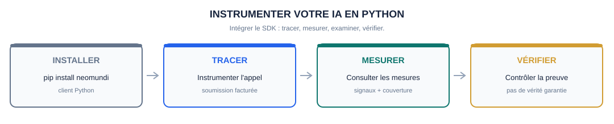

<div align="center">

[](README_FR.md) · [](README.md)

# SDK Python NeoMundi

### Installer. Mesurer. Vérifier.

**Moins de suppositions. Plus de preuves.** Instrumentez une interaction IA, examinez les signaux mesurés et leur provenance, puis accédez depuis Python aux contrôles de vérification disponibles.

**[Commencer](#install)** · **[Première mesure](#measure)** · **[Vérifier les preuves](#verify)**

[](https://pypi.org/project/neomundi/)    

Chaîne produit NeoMundi — **INSTALL** → TRACE → MEASURE → VERIFY → ACT. Ce dépôt est le **client Python** : il installe la chaîne dans votre application, instrumente votre propre appel et expose les mesures sans les interpréter. Il n'embarque aucun seuil et ne dérive aucun verdict.

[Architecture produit](https://github.com/neomundi-io/.github/blob/main/docs/PRODUCT_ARCHITECTURE.fr.md) · [Audit des capacités](https://github.com/neomundi-io/.github/blob/main/docs/V2_FUNCTIONAL_AUDIT_2026-11-15.md) · [Tous les composants](https://github.com/orgs/neomundi-io/repositories)

**[neomundi.io](https://neomundi.io/)**

</div>

---

> **Connectez votre application d'IA. Tracez chaque interaction. Mesurez son
> comportement. Vérifiez la preuve.**

**INSTALL → TRACE → MEASURE → VERIFY** — les quatre étapes que ce SDK touche.
**ACT** est la cinquième étape de la chaîne : elle est servie par les exports et
les attestations de la plateforme, pas par ce paquet. Les sections ci-dessous décrivent chaque opération, ses prérequis et les preuves qui l'étayent.

## Le parcours d'intégration du SDK

<p align="center">
  <picture>
    <source media="(prefers-color-scheme: dark)" srcset="https://raw.githubusercontent.com/neomundi-io/neomundi-python-sdk/main/docs/assets/sdk-journey-fr-dark.svg">
    
  </picture>
</p>

Le SDK instrumente les interactions et transporte les mesures ; il ne définit pas de politique et ne prouve pas la vérité d'une réponse IA. La soumission d'une trace déclenche une mesure facturée par l'API. La vérification de l'intégrité d'archive exige le paquet Evidence distinct.

---

## Ce que chaque étape fait réellement

| Étape | Ce que c'est | État |
|---|---|---|
| **INSTALL** | `pip install neomundi` — `2.1.0` publiée le 2026-11-15 | **Réel** — `trace()` et `verify()` sont dans la roue publiée |
| **TRACE** | `client.trace()` — chronomètre local, identifiant de corrélation, soumission explicite | **Disponible** — refermer une trace soumet une mesure facturée via l'API ; il n'existe pas de route de traçage seule |
| **MEASURE** | `client.govern()` (REST post-call) et `client.stream()` (proxy de génération SSE) | **Réel** — qualifié en direct contre l'API hébergée le 2026-11-13, REST et SSE tous les deux PASS |
| **VERIFY** | `client.verify()` / `client.verify_audit_certificate()` (routes publiques et non facturées) et `verify_evidence_archive()` (vérificateur Evidence indépendant) | **Réel pour l'authenticité d'émission. L'intégrité d'archive demande un second paquet.** |

Ce qu'**aucune** étape ne fait : établir qu'une réponse d'IA est **vraie**.
Voir [les trois sens du mot « vérifier »](#verify).

## INSTALL

Python 3.9 ou plus récent. `httpx` est la seule dépendance à l'exécution.

```sh
# La version publiée : tout ce qui est documenté ci-dessous.
python -m pip install --upgrade neomundi

# Ou depuis la source, pour contribuer.
git clone https://github.com/neomundi-io/neomundi-python-sdk.git
cd neomundi-python-sdk
python -m pip install -e ".[dev]"
```

`neomundi` **2.1.0** a été téléversée sur PyPI le **2026-11-15** : c'est la
première roue publiée à porter `trace()` et `verify()`. La `2.0.0`
(2026-11-14) ne portait que `govern()` et `stream()` et reste installable.
La publication demeure verrouillée par un flux manuel — tag exact, phrase de
confirmation, environnement GitHub `pypi` et Trusted Publishing : **le numéro
a été re-pointé, aucun verrou n'a été retiré.**

Le code du SDK est sous [Apache-2.0](LICENSE), sous réserve de la revue des
droits des contributeurs ; voir les
[frontières de licence](LICENSE_NOTICE.md). L'**API de mesure hébergée reste
propriétaire et facturée à l'usage** (clé autorisée, crédits ou quotas
applicables, conditions de service). Un SDK ouvert n'inclut aucun accès
gratuit à l'API hébergée.

Aucune clé d'API ni de fournisseur n'est embarquée, lue implicitement ou
conservée. L'environnement de l'API est toujours explicite, par `base_url` :
le SDK ne suppose aucun hôte, afin qu'aucun appel ne parte vers un
environnement non choisi.

## TRACE

```python
import os
from neomundi import NeoMundiClient

with NeoMundiClient(
    api_key=os.environ["NEOMUNDI_API_KEY"],
    base_url=os.environ["NEOMUNDI_BASE_URL"],
) as client:

    with client.trace(client_trace_id="commande-4711", model_name="gpt-4o") as trace:
        reponse, usage = mon_application(question)    # votre propre appel
        trace.record(
            prompt=question,
            response=reponse,
            token_count=usage.total_tokens,           # jamais devine a votre place
        )

    record = trace.record_
    record.latency_ms     # MESUREE autour de votre appel, plus declaree a la main
    record.request_id     # l'identifiant serveur : la seule cle de correlation fiable
    record.acknowledged   # le serveur a traite la requete
    record.registered     # None sur REST : voir ci-dessous
    record.to_dict()      # journalisable : ne porte ni prompt ni reponse
```

**Ce que TRACE apporte, et rien de plus :**

- la latence est **mesurée** par `time.monotonic()` autour de votre bloc, là où
  la 2.0.0 obligeait à la fournir à la main ;
- un identifiant de corrélation à vous, apparié à celui que le serveur renvoie ;
- une trace journalisable telle quelle : `TraceRecord` porte les **longueurs**
  du prompt et de la réponse, jamais leur texte — par construction, pas par
  discipline.

**Ce qu'il refuse de laisser croire :**

- 🔴 **Il n'existe aucune route de traçage sur l'API.** Les huit routeurs
  déployés ont été relevés le 2026-11-15 : aucun n'accepte une interaction sans
  la mesurer. Refermer une trace émet donc `POST /v1/govern`, soit **un appel
  facturé**. `submit=False` n'ouvre aucune socket.
- 🔴 **Le décompte de tokens n'est jamais inventé.** Sans `token_count`, rien
  n'est envoyé et une `ConfigurationError` est levée. Le contrat déployé
  l'exige, et la réponse déployée le republie sous
  `token_count_source: "caller_declared"` — le serveur ne compte rien sur cette
  route.
- 🔴 **`registered` reste `None` sur REST — et c'est désormais un choix du
  SDK, non un manque du serveur.** Jusqu'au 2026-11-15, `POST /v1/govern`
  répondait 200 **même quand l'écriture du journal avait échoué**, et son
  contrat de fil ne publiait aucun champ de persistance. Depuis le
  déploiement de `03e2b344`, **les deux routes publient `log_persisted` et
  `log_write`**, et un appel réel l'a vérifié en production. Ce SDK
  n'interprète pas encore la paire REST : elle arrive dans `unknown_fields`
  et reste lisible par `result.get("log_persisted")`. La typer serait une
  nouvelle fonctionnalité, pas une correction de documentation — donc
  `TraceRecord.from_stream` reste le seul chemin où `registered` porte une
  valeur. Lire le champ brut si la réponse REST est nécessaire aujourd'hui.
- 🔴 **Votre `client_trace_id` n'est pas conservé par le serveur.** Le champ
  `metadata` est accepté par le contrat et abandonné par la route. La
  corrélation vous appartient : conservez le couple
  `(client_trace_id, request_id)`.
- ⚠ « Tracer chaque interaction » signifie que **vous** instrumentez votre
  application. Ce SDK ne s'accroche à aucun cadriciel, et rien n'est tracé que
  vous n'ayez enregistré.

## MEASURE

`govern()` et `stream()` sont **inchangés** : aucune signature existante n'a
bougé. `token_count` et `latency_ms` restent requis, parce que le contrat
déployé les déclare requis et que le serveur n'en dérive aucun.

```python
result = client.govern(
    token_count=128,                               # usage reellement observe
    latency_ms=842.0,                              # latence reellement mesuree
    llm_prompt="Quelle est la capitale de la France ?",
    llm_response="Paris.",
)
result.governance.decision          # ALLOW / FLAG
result.format_score("g_score")      # un None reste None
result.measured_signals             # ce qui a vraiment ete mesure
result.unmeasured_signals           # et pourquoi le reste ne l'a pas ete
result.audit.measurement_version    # le seul numero qui ait un sens scientifique
result.token_count_source           # "caller_declared" : pas un comptage serveur
result.contract_version             # "neomundi.govern.rest/1.0"
```

N'envoyer que des métriques est permis, et alors aucun contrôle sémantique ne
tourne : `measurement.status` vaut `not_attempted`. Une valeur absente reste
`None` — aucune valeur par défaut numérique n'existe dans ce paquet. Un
transport complet peut porter une mesure incomplète, et les deux sont
rapportés séparément.

Pour le proxy de génération SSE — qui appelle votre fournisseur avec votre clé
de fournisseur, et peut engager un coût chez lui comme un débit NeoMundi — voir
[le guide du flux](docs/STREAMING_FR.md). Quatre champs y sont nouveaux et
comptent :

```python
stream_result.log_persisted      # confirmation d'enregistrement (REST la publie aussi depuis le 2026-11-15)
stream_result.log_write          # already_exists / already_exists_divergent / failed
stream_result.token_count_source # provider_usage, ou chunk_count_fallback
stream_result.token_count_unit   # "tokens", ou "chunks" sur le chemin de repli
```

`log_persisted` vaut `True` quand la clé est **absente** : le serveur ne l'émet
que sur le chemin non nominal. Et sur le chemin de repli, `total_tokens` compte
des **chunks**, pas des tokens — lire l'unité avant de comparer deux
observations.

## VERIFY

Trois questions distinctes portent le même verbe. Les mélanger est l'erreur la
plus coûteuse de tout ce parcours.

**1. Authenticité d'émission — réelle, publique, non facturée.**

```python
verdict = client.verify(result.request_id)
verdict.valid                 # True / False / None
verdict.payload_hash_match    # l'empreinte canonique, recalculee cote serveur
verdict.signature_valid       # la signature JWS Ed25519
```

`GET /v1/rgc/verify/{request_id}` recalcule l'empreinte canonique depuis le
journal source **et** vérifie la signature stockée, au lieu de faire confiance
à l'une ou à l'autre. Aucune clé n'est requise et rien n'est facturé.
`valid is None` signifie qu'**aucune vérification n'a eu lieu** : aucun contrat
RGC n'a été émis pour cette observation — un appel distinct, réservé au palier
TIER_03, que ce SDK n'émet pas. Lire ce `None` comme un échec ferait passer
« jamais signé » pour « signature invalide ».

La même règle tri-état gouverne les certificats d'audit, et elle y mord plus
fort :

```python
cert = client.verify_audit_certificate("AT-2026-0001", sha256=celui_imprime_sur_le_pdf)
```

**Sans `sha256`, `valid` vaut `None` et rien n'a été vérifié.** Aucune
empreinte n'est conservée à l'émission : la valeur imprimée sur le document du
porteur est la seule chose contre laquelle le service puisse comparer.

**2. Intégrité d'archive — déléguée au vérificateur indépendant.**

```sh
python -m pip install neomundi-evidence-verify
```

```python
from neomundi import verify_evidence_archive

issue = verify_evidence_archive("archive.zip")
issue.exit_code              # 0, 1, 2, 3 ou 4 — celui du programme
issue.verification_performed # False pour 3 et 4 : rien n'a tourne
issue.passed                 # True / False / None
```

Ce SDK **ne vérifie rien lui-même** : il invoque `neomundi-evidence` et
republie son verdict et son code de sortie sans les retraduire — et un test
interdit à ce module d'importer le moindre outil d'empreinte, d'archive ou de
cryptographie. Un vérificateur absent **lève** au lieu de rendre un verdict :
un outil absent ne produit pas « valide ». Les codes 3 et 4 existent
précisément pour que « rien n'a échoué » et « rien n'a tourné » ne rendent pas
la même réponse.

⚠ Le corpus de conformité n'est **pas** dans la roue PyPI. `pip install`
permet de vérifier **vos** archives ; rejouer le corpus publié demande un
`git clone` du
[Gateway Evidence](https://github.com/neomundi-io/neomundi-evidence-gateway).

**3. Véracité de la réponse de l'IA — 🔴 aucune des deux précédentes.**

Une mesure vérifiée est une mesure dont on sait qu'elle n'a pas été altérée.
Elle ne dit rien de la justesse du contenu mesuré.
`factual_hallucination_score` est un signal produit par un juge, avec ses
limites documentées — pas un verdict de vérité. Aucun certificat émis ici ne
certifie une réponse d'IA.

## Où en sommes-nous ?

| Élément | État |
|---|---|
| Développement REST + SSE | Terminé, inchangé par cette branche |
| Qualification réelle du SDK installé | **Faite le 2026-11-13 : REST PASS, SSE PASS** contre l'API hébergée |
| Déclaration de persistance REST | **Vérifiée en production le 2026-11-15** : un appel autorisé a rendu `log_persisted: true` / `log_write: "inserted"`, et `GET /v1/govern/{request_id}` a retrouvé l'observation. Relire cette ligne stockée rend `log_persisted: null` — un rejeu n'énonce aucun verdict de persistance. |
| Tests hors ligne | 395 réussis ; 12 captures historiques optionnelles ignorées |
| Tests automatisés GitHub | Python 3.9, 3.11, 3.12, 3.13 |
| Parité des schémas déployés | Mesurée octet pour octet en [GitHub Actions](https://github.com/neomundi-io/neomundi-python-sdk/actions/runs/43526131929), et re-mesurée hors ligne par les fixtures de cette branche |
| `trace()` / `verify()` | Publiés dans la `2.1.0` (2026-11-15). Absents de la `2.0.0`. |
| Version de mesure | Le SDK déclare `3.3.0`, vérifié pour `3.3.0` et `3.3.1`. **La production sert `3.5.0`**, qui n'est volontairement **pas** déclarée vérifiée : personne ne l'a vérifiée. L'avertissement que vous verrez est donc correct. |

Cette qualification réelle a éprouvé une mesure complète et un flux
progressif. Elle n'a **pas** éprouvé un agrégat retenu, un vrai chemin
d'erreur (402, 429…) ni plus d'un fournisseur SSE. Des tests hors ligne
réussis n'établissent ni la disponibilité du service, ni la compatibilité avec
tous les fournisseurs. Voir [le périmètre de preuve 3.5.0](docs/COMPATIBILITY_350.md)
et [les vérifications effectuées](docs/VERIFICATION_V2.md).

## Flux de données, en bref

`llm_prompt` et `llm_response` sont transmis au service de mesure et traités en
mémoire. De ces deux, la plateforme conserve : **jamais le prompt** (seulement
sa longueur), et **des extraits de la réponse** dans `quality.suspect_phrases`
quand le score de factualité dépasse son seuil. `rag_context` et `documents` ne
sont jamais conservés. Trois signaux sur cinq tournent sur des modèles hébergés
sur la machine du service ; la factualité et l'instabilité sémantique appellent
un sous-traitant. L'hébergement est en Suisse. `TraceRecord` ne porte aucun
contenu : journaliser une trace ne peut pas faire fuir un prompt.

Détail complet et rétention :
[flux de données et confidentialité](https://github.com/neomundi-io/neomundi-io-data-protection)
et [KNOWN_LIMITATIONS_FR.md](KNOWN_LIMITATIONS_FR.md).

## Documentation

- [Ce que cette branche a audité, et ce qu'elle a changé](docs/AUDIT_INSTALL_TRACE_MEASURE_VERIFY.md)
- [Cycle de vie SSE, erreurs, intégrité et limites](docs/STREAMING_FR.md) · [English](docs/STREAMING.md)
- [Limites connues du backend et du SDK](KNOWN_LIMITATIONS_FR.md) · [English](KNOWN_LIMITATIONS.md)
- [Contrat REST relevé](docs/CONTRAT_API.md) · [Limites de mesure](docs/LIMITES.md)
- [Résultats de vérification et qualification réelle](docs/VERIFICATION_V2.md) · [Périmètre de preuve 3.5.0](docs/COMPATIBILITY_350.md)
- [Migration depuis la v0.1](docs/MIGRATION_V2.md) · [Audit et corrections livrés](docs/AUDIT_SDK_V2.md)
- [Guide pilote REST](PILOT_INTEGRATION_GUIDE_FR.md) · [English](PILOT_INTEGRATION_GUIDE.md)

## Le lancer

Tous les exemples tournent hors ligne sur un transport simulé et sortent en 0.

```sh
python -m pip install -e ".[dev]"
python -m pytest tests
python examples/05_parcours_complet.py    # INSTALL -> TRACE -> MEASURE -> VERIFY
python -m build
```

La version du SDK est une version **client**, pas une version de mesure.
Contrôler la version de mesure que votre déploiement renvoie réellement avant
de comparer deux observations.

---

*Interne : les équipes NeoMundi partent du
cockpit maître,
sélectionnent le chantier dans `CHANTIERS.md`, puis y reviennent après la
mission pour consigner le résultat, les preuves et la prochaine action. Ce
document reste la porte d'entrée détaillée du SDK lui-même. Ce cockpit est un
dépôt privé : il n'est donc volontairement pas lié depuis cette page publique.*
